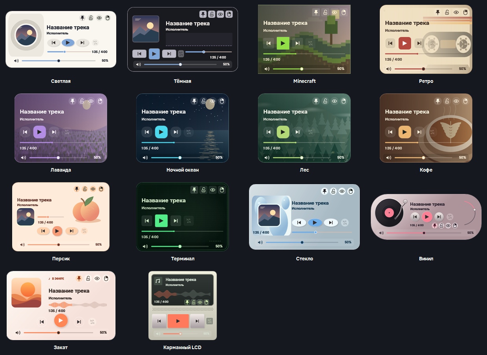

# Mini Player · мини-плеер для Windows

**Ветка: `keksichek/mini-player` · самостоятельное приложение · Windows x64**

Компактный пульт на рабочем столе для Яндекс Музыки и других приложений, которые передают медиасессию Windows. Показывает обложку и информацию о треке, позволяет управлять воспроизведением и закреплять окно поверх других окон.

Музыка продолжает воспроизводиться в исходном приложении или браузере. Mini Player управляет этим источником через системные интерфейсы Windows; вход в музыкальный аккаунт внутри плеера не нужен.

## Для чего эта ветка

Здесь развивается **сам мини-плеер**: управление музыкой, выбор источника, громкость, поведение окна, темы и кастомизация. README описывает возможности кода именно этой ветки.

| Ветка | Назначение |
| --- | --- |
| **`keksichek/mini-player` — текущая** | Самостоятельный мини-плеер и его оформление. |
| [`keksichek/launcher`](https://github.com/Keksichek/mini-player/tree/keksichek/launcher) | Лаунчер, каталог и установка виджетов, интеграция с OBS и редактор оформления для эфира. |
| [`feature/notes-widget`](https://github.com/Keksichek/mini-player/tree/feature/notes-widget) | Виджет заметок и его совместимость с хабом. |
| [`main`](https://github.com/Keksichek/mini-player/tree/main) | Общая базовая ветка репозитория. |
| [`secondary`](https://github.com/Keksichek/mini-player/tree/secondary) | Независимая ветка второго разработчика. |

Ветка сохраняет общую историю проекта, включая ранее внесённые изменения второго разработчика. Обновления между ветками не синхронизируются автоматически. В лаунчер может входить более новая версия плеера с дополнительными функциями; **OBS, его редактор и протокол управления виджетом из хаба в этой отдельной ветке пока отсутствуют**.

## Что уже сделано

- **Управление воспроизведением:** предыдущий трек, пауза/продолжение и следующий трек, если источник поддерживает соответствующую команду.
- **Информация о музыке:** обложка, название, исполнитель, текущее время, длительность и плавно движущийся таймлайн.
- **Перемотка:** нажатием в нужной точке шкалы или перетаскиванием; команда отправляется после отпускания мыши.
- **Выбор источника:** отдельный список медиасессий в настройках для музыкального приложения или браузера.
- **Громкость приложения:** ползунок в настройках и выбор приложения в микшере Windows. Общая громкость Windows не меняется.
- **Поведение окна:** перетаскивание, закрепление поверх окон с изменяющимся значком булавки, скрытие и возврат через трей.
- **Автопоказ для Яндекс Музыки:** появление при сворачивании её отдельного приложения, если Windows позволяет обнаружить его окно.
- **Возврат на экран:** стрелка у края помогает вернуть плеер, если он оказался за границей рабочей области.
- **Оформление:** 14 тем, собственные цвета, масштаб, прозрачность, рамка, параметры обложки и информации о треке.
- **Установка:** собственная иконка, ярлык на рабочем столе и сохранение настроек между запусками.

## Как выглядит плеер



На изображении — демонстрационные треки и обложки. Темы отличаются компоновкой, корпусом, кнопками, таймлайном и фоновыми сценами.

Доступны **Светлая, Тёмная, Minecraft, Ретро, Лаванда, Ночной океан, Лес, Кофе, Персик, Терминал, Стекло, Винил, Закат и Карманный LCD**.

Во время воспроизведения работают тематические анимации: вращение пластинки и катушек, пар над чашкой, светлячки и волны. Часть тем реагирует на уровень звука выбранного приложения; чувствительность настраивается от 0 до 300%. «Стекло» использует полупрозрачное оформление, без размытия рабочего стола.

## Запуск и установка

1. Установите **.NET Desktop Runtime 10 для Windows x64**.
2. Откройте на GitHub ветку **`keksichek/mini-player`**, выберите **Code → Download ZIP** и распакуйте архив целиком.
3. Запустите **Run.cmd** для запуска из распакованной папки или **Install.cmd** для установки с ярлыком на рабочем столе.
4. Включите музыку или видео в исходном приложении.
5. Откройте **⋯ → Настройки** либо **Настройки** в меню значка возле часов и выберите **«Источник трека и кнопок»**.

Установка через `Install.cmd` копирует готовые файлы из `App` в `%LOCALAPPDATA%\MiniPlayer\App`. Права администратора для установки самого плеера не нужны. Автозапуск при входе в Windows этот сценарий не добавляет.

Для работы через лаунчер и OBS используйте [ветку лаунчера и её установщик](https://github.com/Keksichek/mini-player/tree/keksichek/launcher). Это отдельный вариант установки.

## Управление и кастомизация

**Окно.** Перетаскивайте плеер за корпус, обложку, текст или область кнопок. Короткое нажатие на кнопку выполняет её команду. Булавка включает и выключает отображение поверх окон; её вид показывает текущее состояние.

**Настройки.** В меню **⋯** или в трее доступны настройки, кастомизация и скрытие. Вернуть окно можно двойным щелчком по значку в трее или командой **«Показать плеер»**. Полное завершение — **«Выход»** в трее.

**Громкость.** В настройках выберите **«Приложение в микшере Windows»** и используйте ползунок. Для браузера меняется громкость всех его аудиосессий с тем же именем процесса, а не только одной вкладки. Внутренний ползунок сайта может при этом не менять своего положения.

**Оформление.** Откройте **«Кастомизация»** через меню плеера или значок в трее. Доступны выбор темы, цветовой круг для акцента, рамки и фона, масштаб 85–140%, непрозрачность 65–100%, скругление, толщина рамки и отображение исполнителя и времени. Некоторые параметры зависят от компоновки темы. Изменения видны сразу; **«Сохранить»** записывает их, а закрытие окна без сохранения отменяет.

Настройки и оформление находятся в:

```text
%LOCALAPPDATA%/MiniPlayer/
  App/              установленное приложение
  settings.json     позиция, закрепление, источник и настройки звука
  appearance.json   тема и оформление
```

Перед обновлением завершите плеер через трей, распакуйте новую сборку и снова запустите **Install.cmd**. Настройки вне `App` сохраняются. Для удаления завершите плеер и удалите его ярлык и папку `App`; удаление всей папки `MiniPlayer` также удалит настройки.

## Ограничения текущей ветки

- Источник должен публиковать медиасессию Windows. Если браузера нет в списке, сначала запустите в нём воспроизведение. Не каждый сайт передаёт обложку, длительность или команды перемотки и переключения.
- Недоступные у источника команды отключаются. Плеер не может добавить сайту функции, которых нет в его медиасессии.
- Громкость управляется через аудиосессии на устройстве вывода Windows по умолчанию. Если список пуст, включите звук в приложении; при выводе на другое устройство его сессия может отсутствовать.
- Автопоказ при сворачивании относится к отдельному приложению Яндекс Музыки. Для браузеров в этой ветке используйте ручной показ и скрытие.
- Лайки, дизлайки и просмотр очереди следующих треков не реализованы.
- Свободного редактора расположения элементов и загрузки собственных шрифтов здесь пока нет. Редактор OBS находится в ветке лаунчера.

## Разработчикам

Стек: **C#**, **WPF**, **.NET 10**, Windows Media Control и Windows Core Audio. Для сборки из исходников нужен **.NET SDK 10** на Windows.

```powershell
git clone --branch keksichek/mini-player https://github.com/Keksichek/mini-player.git
cd mini-player
dotnet build Source/MiniPlayer.csproj -c Release
```

`Run.cmd` и `Install.cmd` используют готовые файлы из `App`. После правок исходников запускайте результат сборки, например:

```powershell
dotnet run --project Source/MiniPlayer.csproj -c Release --no-build
```

| Путь | Что находится внутри |
| --- | --- |
| [Source/](Source/) | Исходники плеера, управление медиасессиями и интерфейс. |
| [Source/Audio.cs](Source/Audio.cs) | Работа с громкостью и аудиосессиями. |
| [Source/Customize.cs](Source/Customize.cs) | Темы и окно кастомизации. |
| [Source/Timeline.cs](Source/Timeline.cs), [Source/PlaybackClock.cs](Source/PlaybackClock.cs) | Перемотка и расчёт времени воспроизведения. |
| [App/](App/) | Готовая сборка для `Run.cmd` и `Install.cmd`. |
| [screenshots/](screenshots/) | Галерея и снимки тем. |
| [Install.ps1](Install.ps1) | Копирование приложения и создание ярлыка. |

Направление дальнейшей работы — совместимость с источниками, удобство управления и развитие оформления. При переносе функций из лаунчера нужно отдельно учитывать зависимости и различие папок данных.

В сообщении об ошибке указывайте ветку, приложение или сайт, выбранный источник и действия для повторения. Сборка проекта сама по себе не подтверждает работу команд с каждым музыкальным сервисом — это проверяется с реальным источником.
