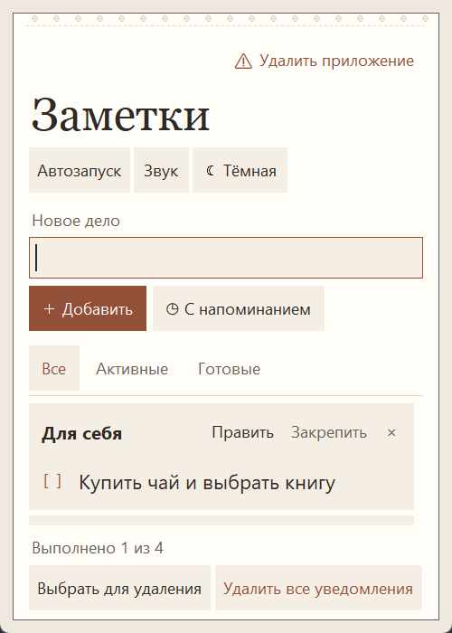
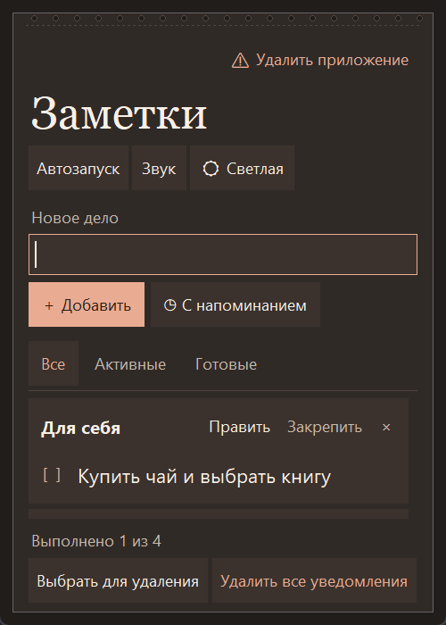
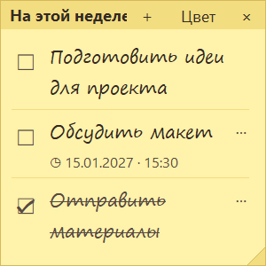

# Заметки — бумажные стикеры и напоминания для Windows

«Заметки» помогают держать под рукой дела, короткие записи и рисунки. Объединяйте их в именованные блоки, закрепляйте блоки поверх окон и задавайте время напоминаний. Виджет работает локально и сохраняет записи между запусками.

**[Скачать установщик для Windows x64](https://github.com/Keksichek/mini-player/releases/download/notes-v0.1.4/Notes-Setup.exe)** · **[Открыть выпуск v0.1.4](https://github.com/Keksichek/mini-player/releases/tag/notes-v0.1.4)** · **[Исходники и инструкция разработчика](widgets/notes/README.md)**

## Как выглядит

Главное окно оформлено как бумажный лист с перфорацией. В нём расположены блоки записей, фильтры и настройки. Есть светлая и тёмная темы. Узкий ползунок появляется при наведении на область списка, когда содержимое не помещается.

| Светлая тема | Тёмная тема |
| --- | --- |
|  |  |

Закреплённый блок становится отдельным цветным стикером. Его можно перемещать за верхнюю полоску и менять размер за загнутый нижний угол.

На изображениях используются вымышленные записи.

## Для чего нужен

- Записывать рабочие и домашние дела, собирать их по темам.
- Держать важный список поверх других окон.
- Получать напоминания о встречах и небольших задачах.
- Сохранять наброски рядом с текстовыми записями.

## Установка

1. Скачайте `Notes-Setup.exe` по ссылке выше и запустите его.
2. Выберите папку установки. Путь можно ввести вручную или указать через «Обзор…».
3. Нажмите «Установить», затем «Открыть Заметки».

Установщик создаёт ярлыки на рабочем столе и в меню «Пуск». По умолчанию приложение устанавливается в `%LOCALAPPDATA%\Programs\Notes`. Готовая версия включает Python и необходимые компоненты — устанавливать их отдельно не требуется.

## Как пользоваться

### Блоки и записи

Введите текст в поле «Новое дело» и нажмите «Добавить». Чтобы сразу задать время, используйте «С напоминанием».

У блока есть отдельное название. Нажмите «Править», заполните «Название блока» и выберите нужную запись в списке. Можно отредактировать несколько записей по очереди и сохранить изменения одной кнопкой. Фильтры «Все», «Активные» и «Готовые» помогают просматривать список.

### Стикеры поверх окон

Нажмите «Закрепить» у блока. На стикере доступны:

| Элемент | Действие |
| --- | --- |
| «＋» | Добавить текст, напоминание или рисунок на этот лист |
| Квадрат рядом с записью | Отметить выполнение |
| «Цвет» | Выбрать один из пяти пастельных оттенков |
| Верхняя полоска | Перетащить стикер |
| Нижний правый угол | Изменить размер |
| «×» | Открепить лист |

Добавленные на стикере записи появляются внутри того же блока в главном окне. Отметки выполнения синхронизируются в обе стороны. Открепление убирает лист с экрана, сохраняя его записи.

### Напоминания и звук

На одном листе может быть несколько записей со своим временем напоминания. Кнопка «Календарь» открывает выбор дня, часов и минут.

В назначенное время появляется карточка цвета соответствующего стикера и звучит сигнал. Выполненные записи пропускаются. Если срок прошёл при закрытом приложении, активное напоминание появится при следующем запуске.

В меню «Звук» можно прослушать сигнал, выбрать свой WAV или MP3 до 30 секунд и вернуть стандартный звук. MP3 автоматически преобразуется в WAV. Подсказка при наведении на «!» объясняет преобразование.

**Для напоминаний приложение должно быть запущено, а компьютер включён.** Проверка расписания выполняется каждые 15 секунд.

### Рисунки

Выберите «＋ → Нарисовать заметку». В редакторе есть белое полотно, цветные чернила, ластик, отмена и повтор действия. Рисунок сохраняется как запись в блоке. Наведите указатель на его значок на стикере для миниатюры или нажмите, чтобы открыть редактор.

### Автозапуск

Кнопка «Автозапуск» позволяет выбрать запуск при входе в Windows:

- Отключён.
- Открыть главное окно.
- Работать в фоне со значком рядом с часами.

В фоновом режиме окно и стикеры скрыты, а напоминания продолжают работать. Щелчок по значку открывает приложение. Значок может находиться под стрелкой скрытых значков. Через его контекстное меню можно выйти.

## Сохранение данных

При первом запуске рядом с программой автоматически создаётся папка `data/`. В ней сохраняются записи, рисунки, даты, отметки выполнения, тема, цвета и выбранный звук. Данные переживают закрытие приложения и выключение компьютера.

Папка `data/` исключена из Git. Для резервной копии закройте приложение и скопируйте эту папку. При обновлении сохраните её. Папка установки должна быть доступна пользователю для записи.

## Удаление

«Выбрать для удаления» позволяет выбрать несколько блоков и напоминаний. Блок удаляется со всеми записями. Снятие напоминания удаляет дату и время, сохраняя текст. «Удалить все уведомления» снимает все напоминания после подтверждения.

Кнопка «⚠ Удалить приложение» расположена отдельно в верхнем правом углу. После подтверждения удаляются файлы этой копии программы, её личные данные, запись автозапуска и ярлыки установщика. **Сама папка установки сохраняется**, даже если стала пустой.

## О ветке

Ветка `feature/notes-widget` содержит текущую самостоятельную версию «Заметок» в `widgets/notes/`. В репозитории также находятся медиаплеер и другие части проекта. Подключение виджета к лаунчеру и установка через его каталог планируются для следующих этапов.
