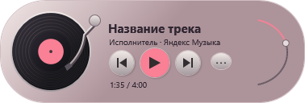
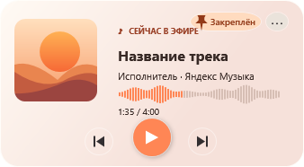
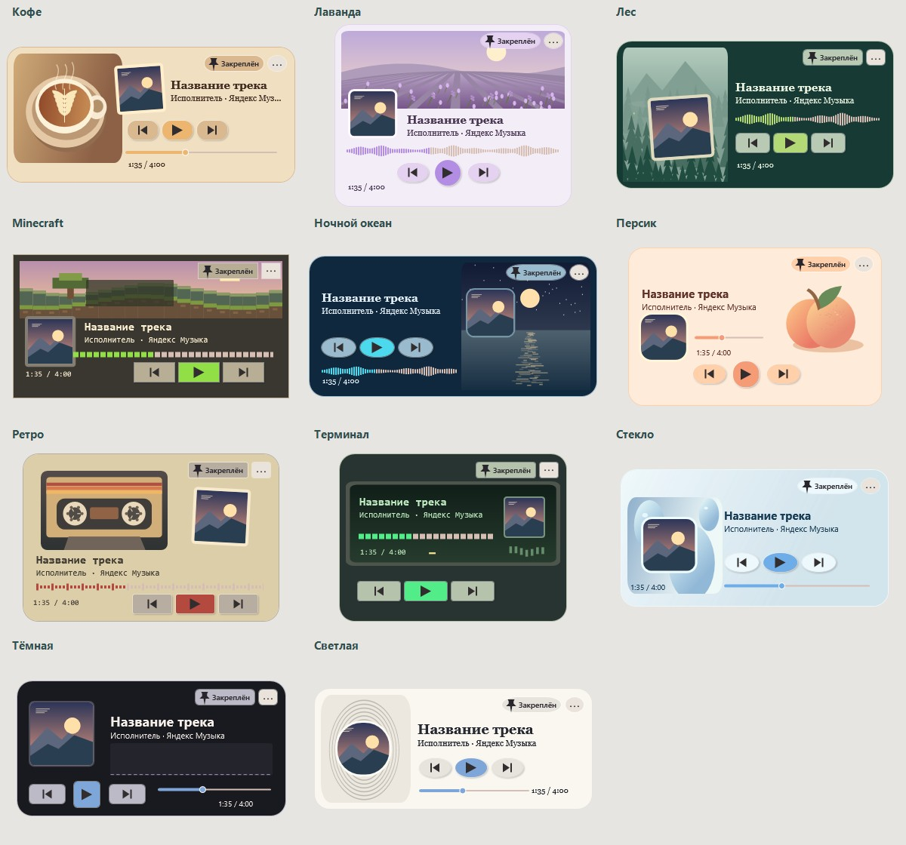

# mini payer

Компактный пульт для приложений с поддержкой системных медиасессий Windows. Показывает обложку и позволяет переключать треки, управлять воспроизведением и громкостью приложения.





## Темы плеера



В «Светлой» обложка расположена в центре колец, которые пульсируют с уровнем звука. В разделе «Кастомизация → Размер и детали → Реакция на музыку» можно настроить чувствительность от 0 до 300% для всех трёх звуковых индикаторов. По умолчанию она равна 100%.

В «Тёмной» столбики показывают историю пиков громкости выбранного приложения. В Minecraft на этот же сигнал реагирует высота травяных холмов. На паузе холмы возвращаются к исходному рельефу. В «Ночном океане» движется лунная дорожка, в «Лаванде» качаются стебли, а в «Персике» меняется блик на плоде. На снимках ранних тем показана демонстрационная обложка.

У каждой темы свой корпус, компоновка и шкала перемотки. При воспроизведении над чашкой поднимается пар, в лесу мерцают светлячки, на кассете вращаются катушки, а на экране терминала мигает курсор.

## Запуск

1. Установите .NET Desktop Runtime 10 для Windows x64.
2. Скачайте проект через **Code → Download ZIP**, распакуйте архив и запустите **Run.cmd**.
3. Включите музыку. В меню значка плеера возле часов откройте **Кастомизация** и выберите тему.

В теме **Винил** пластинка вращается вместе с обложкой. В темах **Закат** и **Карманный LCD** движется волна на шкале перемотки. При паузе движение останавливается.

Для установки с ярлыком запустите **Install.cmd**. Для сборки из исходников на Windows понадобится .NET SDK 10:

```powershell
dotnet build Source/MiniPlayer.csproj -c Release
```

## Управление окном и звуком

Перетаскивайте плеер за корпус, обложку, текст или кнопки воспроизведения. Короткое нажатие на кнопку выполняет её команду. Шкалы поддерживают перетаскивание для перемотки и регулировки громкости.

В развёрнутом окне **Источник трека и кнопок** определяет обложку, название и получателя команд воспроизведения. **Приложение в микшере Windows** выбирает, чей звук меняет ползунок. Плеер ищет Яндекс Музыку на активных устройствах вывода. Если приложения ещё нет в списке, включите в нём звук.

## История версий

# Обновление 0.6 — кастомизация
Правой кнопкой по значку плеера возле часов → Кастомизация. Темы: светлая, тёмная, Minecraft, ретро, лаванда; шесть акцентов, размер 85–140%, непрозрачность 65–100%. Изменения видны сразу. Сохранить записывает appearance.json рядом с settings.json; закрытие без сохранения отменяет изменения. Сброс возвращает стандартное оформление, затем нажмите Сохранить. Иконка встроена в EXE и используется в трее и ярлыке. Для обновления выйдите из старого плеера и запустите Install.cmd.

# Обновление 0.5 — размеры
Компактный режим: 300 × 144. Развёрнутый: 350 × 280. Уменьшены обложка и отступы; функциональность сохранена. Перед установкой завершите плеер через трей, затем запустите Install.cmd.

# Исправления 0.4 — громкость приложения и шкала времени

Громкость Windows больше не изменяется. Ползунок управляет аудиосессиями выбранного приложения на текущем устройстве вывода Windows по умолчанию. Приложение определяется по медиасессии, если возможно. Если ползунок недоступен, запустите звук и выберите нужное аудиоприложение в ПЕРВОМ списке под ползунком. ВТОРОЙ список — источник для кнопок воспроизведения. При переключении медиасессии автоматическое сопоставление выполняется заново.

Для браузера громкость меняется у ВСЕХ его аудиосессий/вкладок с тем же именем процесса. Внутренний ползунок сайта или Яндекс Музыки может не изменить своё отображение: используется громкость приложения в системном микшере. Изменения не затрагивают мастер-громкость и другие приложения. Управление только одним видео/вкладкой требует расширения браузера и пока не реализовано. Если приложение использует другое устройство вывода, его сессия в списке может отсутствовать.

Клик по шкале и перетаскивание теперь обрабатываются отдельным прозрачным слоем на всю высоту шкалы. Короткое нажатие без движения отправляет позицию при отпускании мыши. Это устраняет зависимость от стандартной обработки бегунка Slider. Поддержка перемотки самим сайтом/приложением по-прежнему обязательна.

Проверено: сборка без предупреждений, расчёт позиции, 9 попаданий в разные части области шкалы, получение трёх аудиосессий, отрисовка интерфейса. Фактическое изменение звука и перемотка живого видео в этой проверке не выполнялись.

Для обновления выйдите через трей, распакуйте архив и запустите Install.cmd.

Сведения ниже относятся к предыдущим версиям; при расхождениях действует описание 0.4 выше.
# Обновление 0.3

- Компактный режим: 340 × 156. Кнопка ⋯ раскрывает настройки.
- Громкость Windows: ползунок 0–100% в развёрнутом режиме; синхронизируется с текущим устройством вывода раз в секунду. Это общая громкость, не громкость отдельной вкладки.
- Перемотка кликом в любой точке шкалы и перетаскиванием. Команда отправляется при отпускании мыши; при смене трека в процессе жеста отменяется.
- Список источников подписан идентификатором приложения и названием медиатрека. Выбранный объект медиасессии сохраняется, вместо возврата к первой вкладке того же браузера.
- Пауза и воспроизведение используют отдельные команды Pause/Play, при необходимости Toggle. Нельзя гарантировать Next/Previous у сайта, который их не предоставляет Windows; соответствующие кнопки отключаются.
- Автоскрытие за окном Яндекс Музыки не применяется к выбранной сессии браузера.
- Убраны неработающие значки лайков/дизлайков/очереди из компактного интерфейса. Эти функции по-прежнему НЕ реализованы.

Перед обновлением: значок в трее → Выход. Затем распакуйте архив и запустите Install.cmd.
Проверены сборка, оба макета, расчёт позиции клика на шкале и чтение громкости через Windows Core Audio. Изменение громкости и команды живым вкладкам в тесте не отправлялись. Если браузер не появляется, запустите видео на сайте вручную; пульт управляет только опубликованными Windows медиасессиями, а не всеми вкладками.

Ниже — инструкции и история предыдущих версий; при различиях применяются сведения 0.3 выше.
# mini payer — первая версия

Windows 11, .NET Desktop Runtime 10 (на компьютере, где создавалась программа, установлен). Неофициальный локальный пульт, не самостоятельный стриминговый сервис. Учётная запись и воспроизведение остаются в Яндекс Музыке.

## Темы плеера


В «Светлой» обложка расположена в центре колец, которые пульсируют с уровнем звука. В разделе «Кастомизация → Размер и детали → Реакция на музыку» можно настроить чувствительность от 0 до 300% для всех трёх звуковых индикаторов. По умолчанию она равна 100%.

В «Тёмной» столбики показывают историю пиков громкости выбранного приложения. В Minecraft на этот же сигнал реагирует высота травяных холмов. На паузе холмы возвращаются к исходному рельефу. В «Ночном океане» движется лунная дорожка, в «Лаванде» качаются стебли, а в «Персике» меняется блик на плоде. На снимках ранних тем показана демонстрационная обложка.

У каждой темы свой корпус, компоновка и шкала перемотки. При воспроизведении над чашкой поднимается пар, в лесу мерцают светлячки, на кассете вращаются катушки, а на экране терминала мигает курсор.

## Запуск
1. Распакуйте архив. Run.cmd запускает без установки. Install.cmd копирует приложение в %LOCALAPPDATA%\MiniPlayer\App и создаёт ярлык на рабочем столе; права администратора не нужны.
2. Откройте Яндекс Музыку и включите трек.
3. Если подключение не выбрано автоматически, выберите медиасессию в выпадающем списке. Названия источников — системные идентификаторы Windows. Для браузера выберите соответствующий браузер; если он публикует несколько вкладок под одним идентификатором, выбор неоднозначен — лучше использовать отдельное приложение.
4. Оставьте «Показывать при сворачивании» включённым. При обнаруженном окне отдельного приложения Яндекс Музыки мини-плеер скрывается, пока основное окно развёрнуто, и показывается, когда оно свёрнуто. Для браузера автоматический показ не поддерживается.

## Управление
- Предыдущий / пауза и воспроизведение / следующий. Недоступные у источника команды отключаются.
- Обложка, название и исполнитель берутся из системной медиасессии Windows; если приложение их не публикует, пульт не может их восстановить.
- Минус и плюс регулируют **общую громкость Windows**, включая другие приложения.
- Булавка включает/выключает режим поверх окон. Перетаскивание за название плеера.
- Крестик скрывает окно. Вернуть — двойным щелчком по значку в трее или через «Показать плеер». Этот ручной показ удерживает окно видимым; выключите и включите флажок автопоказа, чтобы снова следовать сворачиванию.
- Полный выход — меню значка в трее → «Выход». При повторном запуске второго экземпляра новое окно не создаётся.
- Позиция, закрепление, источник и режим сохраняются в %LOCALAPPDATA%\MiniPlayer\settings.json.

## Ограничения и проверка
Сборка прошла без предупреждений. Проверена отрисовка интерфейса. Работа с живой Яндекс Музыкой, обложкой, командами и сворачиванием ещё не проверена в пользовательской сессии. Скрытие основного приложения непосредственно в трей может не определяться как сворачивание, если оно удаляет свой оконный дескриптор. В таком случае используйте ручной показ через трей.

Обновление данных не чаще одного раза в секунду, параллельные запросы не запускаются, обложка декодируется только при смене названия/исполнителя. Изображения больше 8 МБ не загружаются. Пульт не устанавливает глобальный перехват мыши и не требует пароля от Яндекса.

Перед обновлением выйдите из плеера через трей. Для удаления удалите ярлык и папку %LOCALAPPDATA%\MiniPlayer после выхода. Автозагрузка не добавляется.

Исходный код включён в Source. Программа использует официальный API Windows Media Control: https://learn.microsoft.com/en-us/uwp/api/windows.media.control.globalsystemmediatransportcontrolssessionmanager

## Обновление интерфейса 0.2
По умолчанию открывается компактный светлый пульт 410 × 180: обложка слева, управление и шкала времени справа. Кнопка ⋯ переключает развёрнутый режим 410 × 300 с громкостью и настройками. Позиция меняется после отпускания ползунка, а также стрелками клавиатуры; функция зависит от IsPlaybackPositionEnabled у медиасессии. Если во время перетаскивания сменился трек, команда отменяется. Кнопки ♡, ⊘ и ☷ отключены: лайки, дизлайки и очередь следующих треков НЕ реализованы, системный API Windows их не предоставляет. Подсказки объясняют ограничение. Сборка и отрисовка обоих режимов проверены; перемотка в живом приложении ещё не проверена.


Обновление 0.7: закреплённый пин вертикальный с подсветкой, откреплённый наклонный без подсветки. В кастомизации два независимых цветовых круга (акцент и рамка), выбор кликом/перетаскиванием и ползунки яркости. Произвольные RGB-цвета сохраняются; старые настройки совместимы. Проверены сборка, преобразование основных цветов, состояние пина и регрессия шкалы.


Обновление 0.8: цветовые круги 140 px вместо 180. Теперь 10 тем: Светлая, Тёмная, Minecraft, Ретро, Лаванда, Ночной океан, Лес, Кофе, Персик, Терминал. Дополнительно: скругление 0–26 px, рамка 0–4 px (0 скрывает), обложка 40–64 px, отображение исполнителя и времени. Окно настроек прокручивается, кнопки сохранения/сброса закреплены снизу. Настройки сохраняются вместе с темой; закрытие без сохранения отменяет изменения.


Обновление 0.9: три цветовых круга по 110 px — акцент, рамка и фон. Темы теперь заменяют шаблоны кнопок, шкал и бегунков времени/громкости; фон рисуется векторными текстурами (пиксели, линии корпуса, волны, листья, мягкие круги). При выборе темы загружаются её цвета и геометрия; после выбора можно менять все цвета вручную. Добавлена тема Стекло с полупрозрачным градиентом и округлыми кнопками, БЕЗ размытия рабочего стола. Нет фоновых анимаций. Проверены сборка, отрисовка всех тем и регрессия шкалы. Настройки старых версий совместимы.

