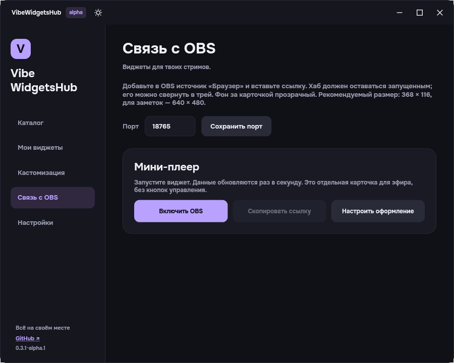
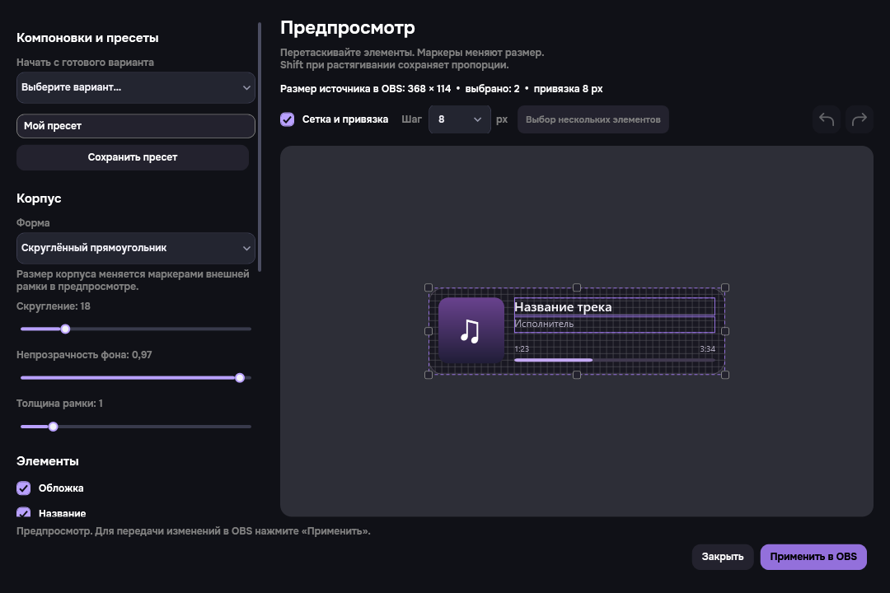

# VibeWidgetsHub · лаунчер виджетов для Windows

**Ветка: `keksichek/launcher` · пре-релиз: `0.3.1-alpha.1` · Windows x64**

Здесь развивается лаунчер: установка и запуск виджетов, общий каталог, настройки, обновления и интеграция с OBS. В сборку входят **мини-плеер** и **заметки**. Код плеера в этой ветке также содержит изменения, необходимые для работы внутри хаба.

[Скачать установщик](https://github.com/Keksichek/mini-player/releases/download/launcher-v0.3.1-alpha.1/WidgetLauncher-Setup.exe) · [Описание пре-релиза и файлы проверки](https://github.com/Keksichek/mini-player/releases/tag/launcher-v0.3.1-alpha.1) · [Подробное руководство](Launcher/README.md) · [История изменений](CHANGELOG.md)

## Назначение веток

| Ветка | Для чего используется |
| --- | --- |
| **`keksichek/launcher` — текущая** | Лаунчер, установка и взаимодействие виджетов, интеграция с OBS и редактор оформления для эфира. |
| [`keksichek/mini-player`](https://github.com/Keksichek/mini-player/tree/keksichek/mini-player) | Отдельная разработка мини-плеера, его управления и оформления. |
| [`feature/notes-widget`](https://github.com/Keksichek/mini-player/tree/feature/notes-widget) | Разработка заметок и подготовка совместимого с хабом пакета. |
| [`main`](https://github.com/Keksichek/mini-player/tree/main) | Общая базовая ветка репозитория. |
| [`secondary`](https://github.com/Keksichek/mini-player/tree/secondary) | Независимая ветка второго разработчика. |

Изменения между ветками не переносятся автоматически. Этот README описывает именно `keksichek/launcher`; возможности отдельной ветки плеера могут отличаться. Лаунчер продолжает общую основу проекта, включая ранее разработанные в `secondary` функции.

## Что уже сделано

- **Каталог и управление виджетами.** Установка, запуск, показ, настройки и удаление. Кнопка «Посмотреть расположение» открывает папку установленного виджета; удаление вынесено к правому краю карточки.
- **Заметки в хабе.** Отдельный EXE-виджет, общий запуск и завершение, собственная папка данных. После удаления виджета записи сохраняются для повторной установки.
- **Установка и обслуживание.** Выбор папки, ярлыки, собственная иконка лаунчера, комплектная среда .NET, перенос установки вместе с данными и несколько режимов автозапуска.
- **Интерфейс.** Дневной и ночной режимы, сворачивание в трей, настройка поведения при закрытии и границ экрана.
- **Оформление настольного плеера.** Галерея из 14 тем, конструктор пресетов, изображения и GIF, сохранение, импорт и экспорт оформления.
- **Обновления.** Проверка подписанных пакетов, сохранение данных и восстановление при неудачном обновлении. Текущий пре-релиз распространяется полным установщиком.
- **Связь с OBS.** Локальные ссылки для плеера и выбранной сохранённой заметки; документированный протокол подключения будущих виджетов.

## OBS и редактор мини-плеера

Раздел **«Связь с OBS»** создаёт ссылку для источника **«Браузер»** в OBS. Плеер передаёт обложку, название, исполнителя, время и прогресс трека. Для заметок можно выбрать конкретную сохранённую запись.



Кнопка **«Настроить оформление»** на карточке мини-плеера открывает отдельный редактор:

- Стартовые горизонтальная, вертикальная, квадратная и круглая компоновки; настройка формы, фона, рамки, прозрачности и цветов.
- Включение и скрытие обложки, названия, исполнителя, времени и таймлайна.
- Перемещение и изменение размеров элементов и корпуса мышью; **Shift** сохраняет пропорции при растягивании.
- **Shift + щелчок** добавляет элементы в группу. После отпускания Shift группу можно перетаскивать вместе.
- Сетка с привязкой и выбором шага. Изменение шага не увеличивает элементы или толщину таймлайна.
- Собственные шрифты **TTF/OTF**, плавная прокрутка длинных названий и сохранение пресетов.
- Отмена **Ctrl+Z**, повтор **Ctrl+Y** и кнопки со стрелками рядом с сеткой.



На снимках используются демонстрационные данные. Изменения редактора попадают в эфир только после **«Применить в OBS»**. Редактор пока доступен только для мини-плеера; его оформление для OBS настраивается отдельно от настольного окна.

Хаб и OBS должны работать на одном ПК; хаб можно свернуть в трей. Для карточки плеера нужен запущенный плеер с выбранным источником музыки. Для заметок хаб читает выбранную сохранённую запись, поэтому сам виджет заметок может быть закрыт. **Звук через эту ссылку не передаётся** — его захват настраивается в OBS отдельно.

[Подключение к OBS, управление редактором и протокол для будущих виджетов →](Launcher/OBS.md)

## Установка

1. Скачайте **WidgetLauncher-Setup.exe** по ссылке в начале README.
2. Выберите папку установки. Необходимая среда запуска входит в комплект; отдельно устанавливать .NET пользователю не требуется.
3. В каталоге выберите виджет → **«Установить»** → **«Запустить»**.
4. Для трансляции откройте **«Связь с OBS»**, включите нужный виджет и добавьте его ссылку в источник **«Браузер»**.

При обновлении закройте хаб и виджеты через трей, затем установите новую сборку **в прежнюю папку хаба**. Настройки и пресеты сохраняются.

Пре-релиз предназначен для проверки перед стабильным выпуском. В репозитории есть релизы разных веток: ссылка выше ведёт именно на сборку `keksichek/launcher`. Для этой версии не опубликован отдельный подписанный пакет автообновления.

## Сборка из исходников

Сборка выполняется на Windows x64. Нужны **PowerShell 7**, **.NET Desktop Runtime 10** и совместимый пакет **notes.zip** из ветки `feature/notes-widget` — с `Notes.exe` и `hub-widget.json` протокола 1. Подготовка пакета заметок описана в [руководстве лаунчера](Launcher/README.md#заметки-интеграция-в-ветке-keksicheklauncher).

```powershell
git clone --branch keksichek/launcher https://github.com/Keksichek/mini-player.git
cd mini-player
pwsh -NoProfile -File .\Build-Launcher.ps1 -NotesPackage C:\Builds\notes.zip
```

`C:\Builds\notes.zip` замените своим путём. Результат — `dist\WidgetLauncher-Setup.exe`. При первой сборке скачивается среда запуска Microsoft; для готового установщика интернет уже не нужен.

| Путь | Содержимое |
| --- | --- |
| [Launcher/](Launcher/) | Интерфейс хаба, каталог, управление виджетами, OBS и редакторы. |
| [Installer/](Installer/) | Установщик и служебные программы установки. |
| [Source/](Source/) | Версия мини-плеера, включаемая в эту сборку хаба. |
| [Shared/](Shared/) | Общий протокол подписанных обновлений. |
| [Tests/](Tests/) | Проверки установки, данных, редакторов, обновлений и OBS. |

## Проверка и дальнейшая работа

Перед выпуском `0.3.1-alpha.1` выполнены 34 набора проверок, 1351 проверка прошла успешно. Проверялись в том числе установка, перенос, удаление, сохранение данных, откат обновления, OBS и редактор. Подробный отчёт `AUDIT.txt` приложен к [пре-релизу](https://github.com/Keksichek/mini-player/releases/tag/launcher-v0.3.1-alpha.1).

Текущее направление ветки — развитие хаба и интеграций. Следующие этапы: расширение редакторов на другие виджеты и дальнейшая свободная настройка настольного плеера. Эти этапы не следует считать уже реализованными возможностями текущего OBS-редактора.

Для сообщения об ошибке укажите версию сборки, действия до ошибки и приложите снимок экрана. Предложения и изменения удобно привязывать к конкретной ветке и виджету.
